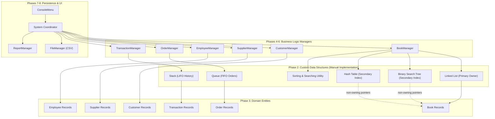

# Book Shop Management System — Team Plan & Master Guide

> **Note for Teammates & AI Assistants:**  
> This document is the primary onboarding guide for the project. It explains the project architecture, our learning philosophy, the system design, the phased implementation roadmap, and strict constraints. Please read this carefully before writing or asking an AI to generate code.

---

## 1. Our Philosophy: Why This Repository is Built This Way

### 🎯 The Goal: Write 100% of the Code Ourselves
This project is for our **Data Structures and Algorithms** university course. The objective is not just to have a working application, but to **deeply understand every pointer, node, traversal, and memory allocation** so we can confidently explain every single line during our project viva/defense.

### 📝 The Blueprint / Skeleton Strategy
**Target layout:** Keep each module's interface and implementation together in its matching header. Some module implementations are still pending; when added, they belong in the header rather than a `.cpp` file.

We intentionally designed it this way so that:
1. **Clear Roadmaps:** Every file explicitly documents its responsibilities, private members, public methods, edge cases, and relationships with other modules.
2. **No "Blank Canvas" Anxiety:** When you open a file (e.g. `LinkedList.h` or `Book.h`), you don't have to guess what fields or methods are needed—the blueprint is already there in comments.
3. **Step-by-Step Learning:** We implement one function at a time, test it in isolation, see it pass, and slowly assemble the entire system like Lego bricks.
4. **Seamless Integration:** Because all function names, return types, and schemas are pre-agreed in the comments, our parts will plug together without breaking.

---

## 2. System Architecture: How It All Works

Our system manages a book shop covering **Books, Customers, Suppliers, Employees, Orders, and Transactions**.

### 🧠 The Core Data Ownership Model (Crucial!)
To prevent memory leaks, dangling pointers, and double-free crashes:
* **The Linked List is the PRIMARY OWNER of Book records.** When a book is added, it lives inside the Linked List.
* **The BST and Hash Table are SECONDARY INDEXES.** They store **non-owning pointers (`Book*`)** pointing directly to the books owned by the Linked List.
  * When a book is deleted: remove its pointer from the BST, remove its pointer from the Hash Table, and finally delete the node from the Linked List.
  * **Destructor Rule:** The BST and Hash Table destructors delete their own index nodes, but **NEVER** delete the `Book` objects they point to.

### 📦 Roles of Each Data Structure
1. **`LinkedList`** (`include/data_structures/LinkedList.h`):
   * Singly linked list storing primary data. Used for `Book`, and as the primary store for `Customer`, `Supplier`, and `Employee` in their managers.
2. **`BST`** (`include/data_structures/BST.h`):
   * Unbalanced Binary Search Tree indexing `Book*` by `bookId`. Enables sorted ascending traversals and fast $O(\log n)$ average lookups.
3. **`HashTable`** (`include/data_structures/HashTable.h`):
   * Fast $O(1)$ lookup for `Book*` by `bookId` using separate chaining with collision buckets. Fixed prime capacity = 11, formula = `abs(key) % 11`.
4. **`Stack`** (`include/data_structures/Stack.h`):
   * LIFO (Last-In, First-Out) stack for **Transaction History**. The newest sales and restocks appear at the top. Searches must preserve stack order.
5. **`Queue`** (`include/data_structures/Queue.h`):
   * FIFO (First-In, First-Out) queue for **Pending Customer Orders**. If an order at the front cannot be fulfilled due to lack of stock, it blocks subsequent orders to preserve strict FIFO fair-ordering.
6. **`SortingSearching`** (`include/data_structures/SortingSearching.h`):
   * Utility module operating on temporary arrays of `Book*`. Implements manual Selection Sort (by ID, Title, Price), Linear Search, and Binary Search (which requires sorting by ID first). **Never alters the Linked List order.**

---

## 3. The Master Phased Roadmap

We follow a strict gated workflow tracked in [docs/IMPLEMENTATION_TRACKER.md](docs/IMPLEMENTATION_TRACKER.md). **Do not skip ahead to future phases.**

| Phase | Milestone | Focus | How to Know It's Done |
| :---: | :--- | :--- | :--- |
| **Phase 1** | **Project Setup** | Folders, skeleton blueprints, documentation | ✅ Complete |
| **Phase 2** | **Data Structures** | Custom manual data structures & independent tests | ⏳ **CURRENT FOCUS** |
| **Phase 3** | **Entity Classes** | `Book`, `Customer`, `Supplier`, `Employee`, `Order`, `Transaction` | All field getters/setters, validation, CSV conversion |
| **Phase 4** | **Book Management** | `BookManager` keeping List, BST, and Hash Table synced | Add, update, delete, search, sort books |
| **Phase 5** | **Other Managers** | `CustomerManager`, `SupplierManager`, `EmployeeManager` | Full CRUD with soft deletion (`active = false`) |
| **Phase 6** | **Orders & Transactions** | Sales workflow, stock reduction, restock, queue, stack | Complete sales/restock lifecycle with stock checks |
| **Phase 7** | **Persistence** | `FileManager` saving/loading CSV files | Startup rebuild of all structures & CSV saving |
| **Phase 8** | **UI & Reports** | `ConsoleMenu`, `ReportManager`, system demo | Interactive console UI, summary reports, viva prep |

---

## 4. Current Work: Phase 2 Step-by-Step Guide

We are currently in **Phase 2**. We implement and test data structures **one by one** in this exact sequence:

1. **`LinkedList`**:
   * Open `include/data_structures/LinkedList.h` $\rightarrow$ implement node structure and list methods.
   * Open `tests/testLinkedList.cpp` $\rightarrow$ write test assertions (empty list, head/tail insertion, deletion, search).
   * Compile and run: `g++ -std=c++11 -Iinclude tests/testLinkedList.cpp -o testLinkedList && ./testLinkedList`.
2. **`Stack`**:
   * Implement in `include/data_structures/Stack.h`, test in `tests/testStack.cpp`. Verify LIFO order and underflow safety.
3. **`Queue`**:
   * Implement in `include/data_structures/Queue.h`, test in `tests/testQueue.cpp`. Verify FIFO order and front/rear resetting on last dequeue.
4. **`BST`**:
   * Implement in `include/data_structures/BST.h`, test in `tests/testBST.cpp`. Test leaf, 1-child, and 2-child (inorder successor) deletions.
5. **`HashTable`**:
   * Implement in `include/data_structures/HashTable.h`, test in `tests/testHashTable.cpp`. Test forced collisions and chain deletion.
6. **`SortingSearching`**:
   * Implement in `include/data_structures/SortingSearching.h`. Define its functions inline in the header and test selection sort and binary search in `tests/testSortingSearching.cpp`.

---

## 5. Strict Constraints & Viva Defense Rules

To get full marks and pass our viva defense, we must strictly respect these rules:

1. 🚫 **NO STL Containers Allowed:**  
   * **STRICTLY FORBIDDEN:** `std::vector`, `std::list`, `std::stack`, `std::queue`, `std::map`, `std::unordered_map`, `std::set`, or `<algorithm>` functions like `std::sort`.
   * **ALLOWED:** Standard library primitives like `std::string`, `iostream`, `fstream`, and `sstream`.
2. 🧹 **Zero Memory Leaks:**  
   * Every `new` must have a corresponding `delete`.
   * Every data structure class must have a working destructor that cleans up all its allocated nodes.
3. 🔒 **No Shallow Copies / Double Deletion:**  
   * Custom data structures should disable copy construction (`LinkedList(const LinkedList&) = delete;`) or implement a deep copy so passing by value doesn't cause a crash.
4. 📄 **Agreed CSV & Formatting Standards:**  
   * **Delimiter:** Standard comma `,` (no commas allowed inside names or titles).
   * **Date format:** `YYYY-MM-DD` (e.g., `2026-12-07`).
   * **Optional foreign IDs:** Use `0` when an ID is not applicable.

---

## 6. Instructions for AI Assistants (Copilot, ChatGPT, Claude, Gemini)

If the user or teammate asks you (an AI assistant) for help with this codebase, you **must adhere to these instructions**:

> 1. **Do not write giant monolithic files or bypass phases:** Check `docs/IMPLEMENTATION_TRACKER.md` to see the current active phase. Only help with the module the user is currently working on.
> 2. **Never suggest STL container replacements:** Do not suggest `std::vector`, `std::map`, `std::list`, or `std::sort`. All data structures and algorithms must be manually implemented.
> 3. **Explain as you guide:** The student wants to write and understand the code. When explaining an algorithm (like BST deletion or Hash collision chaining), explain the pointer movements visually and clearly.
> 4. **Respect the ownership model:** Always remember that `LinkedList` owns `Book` instances, and `BST`/`HashTable` only hold non-owning pointers (`Book*`).
> 5. **Follow the blueprint comments:** The method names, parameters, and behaviors described in the header comments are pre-agreed specifications. Follow them exactly so the modules connect smoothly.

---

## 7. Project Documentation Links

* Detailed Requirements & Context: [docs/PROJECT_CONTEXT.md](docs/PROJECT_CONTEXT.md)
* Live Phase & Milestone Tracker: [docs/IMPLEMENTATION_TRACKER.md](docs/IMPLEMENTATION_TRACKER.md)
* Data Files Specification: [data/README.md](data/README.md)
