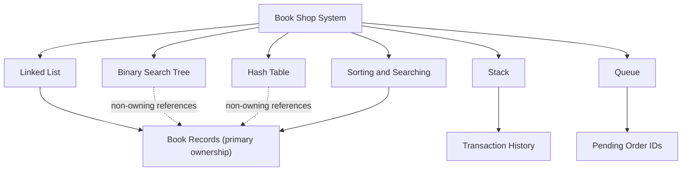

# Book Shop Management System — Project Context & Development Plan

**Project:** Book Shop Management System  
**Language:** C++  
**Project type:** Console-based application  
**Team size:** 2  
**Submission deadline:** 7 December 2026  
**Purpose:** Shared project context for both teammates and coding agents (such as GitHub Copilot). This document describes scope, architecture, ADT contracts, implementation sequence, constraints, tests, and agent guidance.

---

## 1. Project goal

Build a menu-driven C++ Book Shop Management System that manages books, customers, suppliers, employees, orders, and transaction history. Demonstrate manually implemented data structures and algorithms, object-oriented design, file handling, validation, testing, and reporting.

Work incrementally: implement each module, test it independently, and then integrate it.

## 2. Scope

### Core entities
- **Book:** book ID, title, author, category, price, stock quantity, supplier ID, active status.
- **Customer:** customer ID, full name, phone, address, active status.
- **Supplier:** supplier ID, name, phone, address, active status.
- **Employee:** employee ID, full name, role, phone, active status.
- **Order:** order ID, customer ID, book ID, quantity, date, status.
- **Transaction:** transaction ID, transaction type, date, book ID, optional customer/supplier/employee IDs, quantity, unit price, total amount, optional order ID.

Transaction is a history record in addition to the five primary entities (Book, Customer, Supplier, Employee, Order).

### Main features
- CRUD operations: add, update, delete, search, and display.
- Sales with stock validation and stock reduction.
- Restocking with stock increase and transaction record.
- Pending-order processing.
- Transaction history and search by date or ID.
- Reports and system summary.
- Persistence through files.
- Menu-driven interface, validation, and error handling.

### Explicit non-goals unless approved
Do not add online payments, web application features, cloud services, external database integration, authentication, or unrelated features. Avoid feature creep.

## 3. Instructor requirements and constraints

Requirements discussed by the team include:
- At least five major entities.
- CRUD functionality.
- At least one transaction workflow that validates availability, updates status, records a log/history entry, and persists data.
- Stack-based logs/history (latest first).
- Transaction/history search by date or ID.
- System summary report.
- Manual implementation of linked list, BST, stack, queue, hash table, and required sorting/searching algorithms.
- File handling: load data at startup and save changes.
- Object-oriented design; confirm the instructor's precise class-count requirement.
- Menu-driven application, validation, and exception/error handling.
- Report, diagrams, screenshots, conclusion, and viva demonstration.

Verify implementation and test evidence against the requirements; do not assume a requirement is fulfilled merely because it is mentioned.

## 4. Architecture and data ownership

### Book records and indexes
- The **Linked List** is the primary owner of Book records.
- The **BST** and **Hash Table** are secondary indexes for Book ID lookup.
- The BST and Hash Table should store non-owning references/pointers to owned Book records, not independent copies.
- Adding/removing a book must keep the collection and both indexes consistent.
- Updates must not leave indexes inconsistent.

### Manager/system layer
Managers or system-level services coordinate operations and enforce business rules. The main system should coordinate modules rather than contain every implementation detail.

### Persistence
A centralized File Manager is proposed. Data files are proposed as text/CSV files. Exact CSV escaping, date format, and save strategy must be confirmed before implementation.

## 5. ADT specifications

These are interface and behaviour contracts, not implementation code. Names may be adjusted for consistent C++ conventions, but the operations and behaviours should be preserved unless explicitly revised.

### 5.1 Linked List ADT

**Purpose:** Primary collection/owner for Book records; also useful for standalone integer tests.  
**Implementation:** Singly linked list.

**Data:** `head` pointer and element count (`size`). Each node contains data and a pointer to the next node.

| Operation | Input | Output | Purpose |
|---|---|---|---|
| `insertAtBeginning(data)` | Element | void | Insert at head |
| `insertAtEnd(data)` | Element | void | Insert at end |
| `deleteNode(id)` | ID/key | bool/status | Delete matching element |
| `search(id)` | ID/key | pointer or `nullptr` | Locate element |
| `display()` | None | void | Display elements |
| `isEmpty()` | None | bool | Check empty state |
| `getSize()` | None | int | Return element count |

**Behaviour:**
- Inserting into an empty list updates `head`.
- End insertion places the node after the last node.
- Deleting the head advances `head`.
- Deleting a missing key does not modify the list.
- Searching for a missing key returns `nullptr`.
- Empty display is handled clearly.
- Nodes are released by the list; the list has a destructor.

### 5.2 Binary Search Tree (BST) ADT

**Purpose:** Secondary index for searching by unique Book ID and displaying IDs in sorted order.  
**Implementation:** Standard unbalanced BST. Nodes store a Book reference/pointer or suitable element, plus left/right child pointers. Integrated BST entries should be non-owning Book pointers.

| Operation | Input | Output | Purpose |
|---|---|---|---|
| `insert(data)` | Element | bool/status | Insert |
| `search(id)` | ID | pointer or `nullptr` | Find |
| `deleteNode(id)` | ID | bool/status | Delete |
| `inorderTraversal()` | None | void | Traverse ascending IDs |
| `isEmpty()` | None | bool | Check empty |
| `getHeight()` | None | int | Return height |
| `getRoot()` | None | Node pointer (if needed) | Access root |

**Behaviour:**
- Smaller IDs go left; larger IDs go right.
- Duplicate IDs are rejected.
- Empty search returns `nullptr`.
- Deletion handles leaf, one-child, and two-child cases.
- In-order traversal yields ascending IDs.

**Height convention:** Empty tree = `-1`; leaf = `0`.

This is not an AVL tree. Do not implement rotations or balancing unless the instructor requires them. The BST destructor must not delete Book records it does not own.

### 5.3 Hash Table ADT

**Purpose:** Secondary index for fast Book ID lookup.  
**Implementation:** Array of buckets using separate chaining; bucket chains are manually implemented.

**Data:** Bucket array, capacity, and optionally entry count.

| Operation | Input | Output | Purpose |
|---|---|---|---|
| `hashFunction(key)` | Key | int | Calculate bucket index |
| `insert(data)` | Element | bool/status | Insert |
| `search(key)` | Key | pointer or `nullptr` | Find |
| `remove(key)` | Key | bool/status | Delete |
| `display()` | None | void | Display buckets |
| `isEmpty()` | None | bool | Check empty |

**Behaviour:**
- Collisions use separate chaining.
- Duplicate IDs are rejected.
- Removing one key does not remove unrelated entries in the chain.
- Empty buckets are safe to search.
- Missing keys return a clear failure result.

**Confirm before coding:** initial capacity, exact hash function, and whether resizing is required. A fixed initial capacity is the current simple proposal.

### 5.4 Stack ADT

**Purpose:** Transaction history, newest transaction available first.  
**Implementation:** Linked-list-based stack.

**Data:** `top` pointer and `size`.

| Operation | Input | Output | Purpose |
|---|---|---|---|
| `push(data)` | Element | void/status | Add at top |
| `pop()` | None | Element or status | Remove top |
| `peek()` | None | Element/reference or status | View top without removal |
| `isEmpty()` | None | bool | Check empty |
| `getSize()` | None | int | Return count |
| `display()` | None | void | Display top to bottom |

**Behaviour:** Push adds at top; pop removes the most recently pushed element; peek does not remove; empty pop/peek are handled safely.

**Integrated-system consideration:** History search must not permanently remove transactions. If temporary popping is used for search/traversal, restore elements to their original order. Alternatively, use a safe traversal approach consistent with the manual Stack requirement.

### 5.5 Queue ADT

**Purpose:** Pending order IDs in FIFO order.  
**Implementation:** Linked-list-based queue.

**Data:** `front`, `rear`, and `size`.

| Operation | Input | Output | Purpose |
|---|---|---|---|
| `enqueue(data)` | Element | void/status | Insert at rear |
| `dequeue()` | None | Element or status | Remove front |
| `peekFront()` | None | Element/reference or status | View front |
| `peekRear()` | None | Element/reference or status | View rear |
| `isEmpty()` | None | bool | Check empty |
| `getSize()` | None | int | Return count |
| `display()` | None | void | Display front to rear |

**Behaviour:** Enqueue adds at rear; dequeue removes from front; removing the last entry sets both front and rear to empty; empty dequeue/peek are handled safely; cancelled orders may be skipped when they reach front.

**Pending-order policy proposal:** FIFO. If the front order cannot be fulfilled in full, stop processing later orders to preserve FIFO. Confirm this policy before implementation.

### 5.6 Sorting and Searching algorithms

These are algorithms, not data structures. Implement them as a utility module.

#### Selection Sort

| Operation | Input | Output | Purpose |
|---|---|---|---|
| `selectionSortByTitle(array, size)` | Book pointer array and size | void | Sort by title |
| `selectionSortByPrice(array, size)` | Book pointer array and size | void | Sort by price |

- Implement Selection Sort manually.
- Sort a temporary array of Book pointers.
- Do not alter the primary Linked List order merely to display sorted results.

#### Searching

| Operation | Input | Output | Purpose |
|---|---|---|---|
| `linearSearch(...)` | Collection/array and key | Index/pointer | Sequential search |
| `binarySearch(...)` | Sorted array and key | Index or `-1` | Search sorted data |

- Linear Search works on sorted or unsorted data.
- Binary Search requires the array sorted by the same key.
- Binary Search will use Book ID on a temporary array sorted by Book ID.
- Do not perform Binary Search directly on a Linked List.
- Missing array element returns `-1`; pointer-based search returns `nullptr`.

## 6. ADT relationship and data ownership diagram



## 7. Empty-state conventions and safe operations

- Linked List: `head == nullptr`.
- BST: `root == nullptr`.
- Stack: `top == nullptr`.
- Queue: `front == nullptr` and `rear == nullptr`.
- Hash Table: all buckets empty.

Use consistent safe-operation contracts. Operations that may fail due to an empty structure or missing key should use a consistent status result. For value retrieval, agree on a pattern such as returning status and writing the value into a reference parameter. Avoid invalid/uninitialized returns.

## 8. Memory ownership and STL restrictions

- Every dynamically allocated node must be released by its owning structure.
- Data structures should have appropriate destructors.
- BST and Hash Table must not delete Book records owned by the Linked List.
- Do not replace mandatory manual structures/algorithms with STL containers or algorithms such as `std::list`, `std::stack`, `std::queue`, `std::map`, `std::unordered_map`, `std::vector`, or `std::sort`.
- Standard facilities such as `std::string`, `iostream`, and `fstream` may be used.
- Keep code beginner-friendly and explainable in the viva.
- Avoid unnecessary complexity and feature creep.

## 9. Project structure (Phase 1–2 only)

Create these folders and files now; files can initially be empty:

```text
BookShopManagement/
│
├── include/
│   └── data_structures/
│       ├── LinkedList.h
│       ├── BST.h
│       ├── HashTable.h
│       ├── Stack.h
│       ├── Queue.h
│       └── SortingSearching.h
│
├── src/
│   ├── main.cpp
│   └── SortingSearching.cpp
│
├── tests/
│   ├── testLinkedList.cpp
│   ├── testBST.cpp
│   ├── testHashTable.cpp
│   ├── testStack.cpp
│   ├── testQueue.cpp
│   └── testSortingSearching.cpp
│
├── data/
│
├── .gitignore
└── README.md
```

**Folder responsibilities:**
- `include/data_structures/`: ADT headers and implementations (templates generally remain in headers).
- `src/`: main program and non-template implementation files.
- `tests/`: independent tests.
- `data/`: files to be introduced in later phases.

## 10. Phase 1 setup checklist

- [ ] Create project root and folders.
- [ ] Create listed empty files.
- [ ] Initialize Git.
- [ ] Create `.gitignore`.
- [ ] Write a concise README.
- [ ] Both teammates can compile and run a basic project.
- [ ] Agree on naming, formatting, and interfaces.
- [ ] Commit the initial skeleton.

**Phase 1 completion:** Both teammates share the same structure/repository/interface conventions and can build and run the project.

## 11. Phase 2 implementation order

1. Linked List.
2. Stack.
3. Queue.
4. BST.
5. Hash Table.
6. Sorting and Searching.

This sequence is proposed to reuse concepts and reduce complexity. Adjust only with a clear reason; avoid implementing multiple untested structures simultaneously.

### Testing expectations for every structure

Test at least:
- Empty structure.
- First insertion.
- Multiple insertions.
- Normal search/access.
- Missing element/key.
- Normal removal.
- Special first/last removal, where applicable.
- Structure after removal.
- Duplicate insertion, if prohibited.
- Memory cleanup and repeated use.

Additional BST tests:
- Leaf deletion, one-child deletion, two-child deletion.
- In-order traversal.
- Height for empty tree and leaf.

Additional Hash Table tests:
- Collisions.
- Multiple keys in one bucket.
- Removal within a collision chain.
- Search after removal.

Additional Stack/Queue tests:
- Empty removal.
- Empty peek.
- Removal of the only element (empty state afterward).
- Multiple elements verifying LIFO/FIFO.

Additional sorting/searching tests:
- Empty and one-element arrays.
- Already sorted and reverse order.
- Equal values where relevant.
- Missing search key.
- Binary Search on correctly sorted data.

**Phase 2 completion:** All data structures and algorithms are independently implemented, tested, understood by both teammates, and ready for integration.

## 12. Future phases (do not create these files yet)

### Phase 3 — Entity classes
Book, Customer, Supplier, Employee, Order, Transaction.

### Phase 4 — Book Management
Add, update, delete, search, display books; keep Linked List, BST, and Hash Table consistent; implement book sorting/searching.

### Phase 5 — Customer, Supplier, Employee Management
CRUD and validation for each.

### Phase 6 — Orders and Transactions
Orders, pending-order Queue, sales and stock validation, restocking, Transaction Stack and history search.

### Phase 7 — Persistence and integration
File Manager, load at startup/save changes, rebuild indexes, preserve pending Queue order, integrate modules.

### Phase 8 — Reports, testing, submission
Reports, main menu, validation/exception handling, full tests, documentation, screenshots, conclusion, and viva preparation.

## 13. Proposed future data files

```text
data/
    books.csv
    customers.csv
    suppliers.csv
    employees.csv
    orders.csv
    transactions.csv
    pending_queue.csv
```

## 14. Milestone schedule

| Target dates | Milestone |
|---|---|
| Nov 15–17 | Blueprint review, setup, interface agreements |
| Nov 18–21 | Data structures and independent tests |
| Nov 22–23 | Entity classes |
| Nov 24–26 | CRUD managers |
| Nov 27–29 | Order and transaction workflows |
| Nov 30–Dec 1 | File handling and integration |
| Dec 2–3 | Main menu, reports, system testing |
| Dec 4–5 | Bug fixes and documentation |
| Dec 6 | Viva rehearsal and backup |
| Dec 7 | Submission |

These are targets; adjust based on verified progress while protecting integration, testing, and documentation time.

## 15. Instructions for coding agents

When working in this repository:

1. Read this document before proposing or writing code.
2. Work only on the task explicitly requested; do not silently implement unrelated modules.
3. Respect the current phase. Do not prematurely add entity, manager, persistence, or UI features while working on Phase 1 or Phase 2.
4. Follow ADT contracts unless the user explicitly approves a change.
5. Manually implement required data structures and algorithms; do not replace them with STL containers or algorithms.
6. Prefer beginner-friendly C++ that both students can explain.
7. Avoid overengineering, unnecessary design patterns, dependencies, and features.
8. Explain the impact before changing interfaces.
9. Include or update independent tests for the task.
10. Run tests when tools are available; never claim a test passed if it was not run.
11. Report changed files, implementation details, test results, known issues, and next recommended task.
12. Verify behaviour rather than assuming a module is complete because it exists.
13. Do not introduce prohibited STL substitutes (`std::vector`, `std::list`, `std::stack`, `std::queue`, `std::map`, `std::unordered_map`, `std::sort`).
14. Keep README and this context document in sync when approved project-wide decisions change.
15. Preserve the team's ability to explain the code during viva.

## 16. Design decisions to confirm

These are proposals, not immutable facts:
- [ ] Hash Table capacity and hash formula.
- [ ] Hash Table resizing policy.
- [ ] Stack/Queue retrieval and removal return conventions.
- [ ] BST and Hash Table Book-pointer representation.
- [ ] Ownership and destruction rules.
- [ ] Pending-order policy when front order cannot be fulfilled.
- [ ] Cancellation handling and Queue cleanup.
- [ ] CSV format and escaping.
- [ ] Date format.
- [ ] ID generation versus manual IDs.
- [ ] Sorting keys and display behaviour.
- [ ] Instructor's interpretation of class-count requirements.
- [ ] Validation and deletion/reference rules.

## 17. Definition of done

A module is complete only when:
- Its agreed interface is implemented.
- Normal operations work.
- Empty and edge cases are handled.
- Independent tests pass.
- Memory ownership is clear and correct.
- Prohibited STL replacements are not used.
- Code is readable and explainable by both teammates.
- It is ready for integration without unapproved interface changes.

---

**Current stage:** Phase 1 setup and Phase 2 data structures.  
**Immediate next task:** Complete the project skeleton, then implement and independently test the Linked List.  
**Source of truth:** This document and the approved team blueprint. Proposed decisions require confirmation; do not treat them as instructor-mandated facts unless verified.
